# Design Optimization of Tokamak Fusion Reactor through Deep Reinforcement Learning

[](https://arxiv.org/abs/2409.08231)

## Introduction
This repository contains the Python code for the paper [Design Optimization of Nuclear Fusion Reactor through Deep Reinforcement Learning](https://arxiv.org/abs/2409.08231) (Jinsu Kim and Jaemin Seo).

We investigate deep reinforcement learning (DRL) as a practical tool for constrained, multi-objective optimization of tokamak fusion reactor designs. The task is to find design configurations that

1. minimize the building cost $C$,
2. maximize the energy gain $Q$, and
3. maximize the energy confinement time $\tau_E$,

while satisfying four operational limits required for stable steady-state operation: the **Greenwald density limit**, the **Troyon beta limit**, the **kink safety factor limit**, and the **bootstrap fraction limit**. Because the objectives and constraints come from a coupled physics-engineering evaluation, they are black-box functions of the design variables. To handle this, we combine **Proximal Policy Optimization (PPO)** with **Reward-Constrained Policy Optimization (RCPO)**, which integrates the constraints into the reward through adaptive Lagrange multipliers and guides the policy toward feasible designs.

We compare the proposed method with four other optimization methods: Grid Search (GS), Genetic Algorithm (GA), Particle Swarm Optimization (PSO), and Bayesian Optimization (BO). The RCPO-based DRL approach finds the highest proportion of feasible designs (11.0%, compared with 0.6–3.0% for the other methods) and gives the most balanced improvement across the competing objectives.

## Reactor design computation
Following the system-level design procedure of Freidberg et al., we implemented a reactor design computation code that determines the geometry, plasma parameters, and performance of a steady-state tokamak from nine input design variables. The computation consists of four steps: (1) geometrical design, (2) plasma parameters, (3) current drive and bootstrap current, and (4) evaluation against the operational limits. The code also accounts for the maximum allowable stress on the TF coils and the neutron wall loading.

<div>
    <p float = 'left'>
        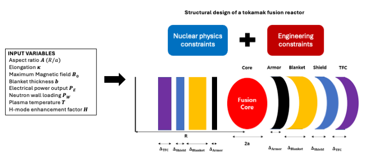
    </p>
</div>

The input design variables and the search space used for optimization are:

| Input parameter | Description | Search space |
|:---:|:---|:---:|
| $\beta_N$ | Normalized beta | [2.0, 4.0] |
| $\kappa$ | Elongation | [1.5, 1.9] |
| $A$ | Aspect ratio | [3.5, 4.5] |
| $\bar{T}$ (keV) | Average temperature | [10, 15] |
| $B_{\max}$ (T) | Maximum magnetic field on the TF coil | [10, 16] |
| $H$ | Confinement enhancement factor | [1.0, 1.3] |
| $\Delta_{\text{Armour}}$ (m) | Armour thickness | [0.01, 0.05] |
| $\eta_{\text{RF}}$ | RF recirculating power rate | [0.1, 0.2] |
| $P_E$ (MW) | Electric power | [500, 1500] |

The code computes the performance of a designed reactor, such as its position relative to the Lawson criterion and its operational regime with respect to the four limits. The figures below are for the reference design from Freidberg's paper. In the operational-regime plot, each curve must lie in the unshaded region for steady-state operation; the reference design violates the kink safety factor and bootstrap fraction conditions.

<div>
    <p float = 'left'>
        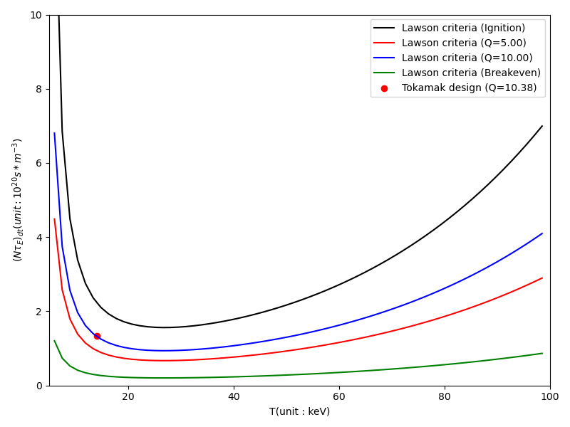
    </p>
</div>

<div>
    <p float = 'left'>
        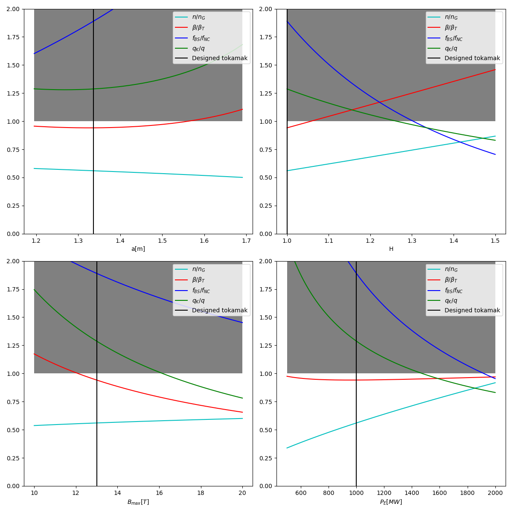
    </p>
</div>

## Design optimization through PPO-based RCPO
The reactor design computation code serves as the environment for the agent. The actor-critic agent selects the nine input design variables as its action, the environment computes the resulting reactor design and plasma parameters as the next state, and the reward is evaluated from the design performance. Training the agent is therefore the optimization of the reactor design.

<div>
    <p float = 'left'>
        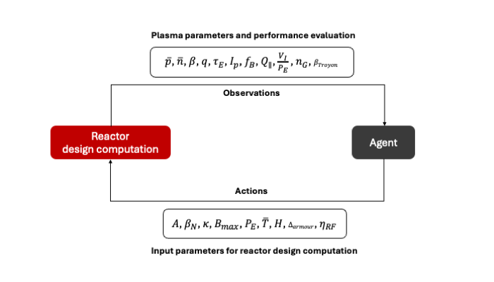
    </p>
</div>

**Reward.** Each design objective is rewarded relative to the reference design through a sigmoid $R(x) = \sigma(x / x_{\text{ref}})$ for $x \in \{1/C, \tau_E, Q\}$. The operational limits are expressed as constraint residuals

$$C_G = \frac{\bar{n}}{n_G} - 1, \quad C_\beta = \frac{\beta}{\beta_{\text{Troyon}}} - 1, \quad C_q = \frac{q_{\text{kink}}}{q} - 1, \quad C_{\text{bs}} = \frac{f_{\text{op}}}{f_{\text{bs}}} - 1,$$

and a design is feasible only if all four residuals are negative. The total reward is

$$R_{\text{total}} = w_C R_C + w_{\tau_E} R_{\tau_E} + w_Q R_Q - \lambda_G C_G - \lambda_\beta C_\beta - \lambda_q C_q - \lambda_{\text{bs}} C_{\text{bs}}.$$

**RCPO.** Instead of fixing the penalty weights, RCPO treats the Lagrange multipliers $\lambda$ as learnable parameters. The policy is updated with the PPO clipped surrogate loss on a fast timescale, while $\lambda$ is updated on a slower timescale according to the average constraint violation in each batch: it grows when the policy violates the constraints and relaxes when the policy is feasible.

**Single-step formulation.** Because a reactor design is evaluated at a single operating point, each episode is a single design proposal that is evaluated immediately. After each policy update, the trajectory buffer is reinitialized from the reference design parameters to stabilize training.

**Offline and online stages.** For GA, PSO, BO, and DRL, the first 1,000 iterations form an offline stage in which candidate designs are sampled randomly and used to initialize each method (the candidate pool for GA/PSO, the Gaussian process for BO, and the critic network for DRL). The remaining iterations form the online optimization stage.

## Installation
The code requires Python 3 and the following packages:
```
pip install numpy torch scipy scikit-learn matplotlib joblib tqdm
```

## How to execute
All scripts must be run from the repository root.

### Computation of the tokamak reactor design
Compute and plot the reference design, or the optimal design found by one of the optimizers (run the corresponding optimizer first):
```
python3 compute_design.py --use_benchmark True
python3 compute_design.py --algorithm {gridsearch, genetic, particle, bayesian, rl, crl}
```
The figures (Lawson criterion, poloidal cross-section, plasma profiles, and operational regime) are saved to `results/design/<method>/`. To compute the optimized design, omit `--use_benchmark` rather than passing `False`.

### Finding the optimal tokamak design
Each optimizer runs for 5,000 iterations by default and saves its results to `results/<method>/`:
```
python3 find_gridsearch.py --num_episode 5000                                                       # Grid Search
python3 find_genetic.py    --pop_size 32 --mutation_rate 0.4 --mutation_sigma 1.96                  # Genetic Algorithm
python3 find_swarm.py      --n_particles 16 --w 0.2 --c1 0.1 --c2 0.1                               # Particle Swarm Optimization
python3 find_bayesian.py   --buffer_size 512 --xi 0.01 --n_restart 16                               # Bayesian Optimization
python3 find_drl.py        --lr 2e-4 --gamma 0.995 --eps_clip 0.2 --entropy_coeff 0.05              # PPO (unconstrained)
python3 find_cdrl.py       --lr 2e-4 --lr_lamda 2e-4 --gamma 0.995 --eps_clip 0.2 --entropy_coeff 0.05  # PPO + RCPO (proposed)
```
Run `python3 <script>.py --help` to see all available options.

> **Note.** The commands above show the code defaults. The paper used 32 particles with an update weight of 0.3 for PSO, and a discount factor $\gamma = 0.999$ for DRL.

### Comparing the optimization results
After running all optimizers and computing their optimal designs, generate the comparison figures:
```
python3 plot_analysis.py
```
The figures are saved to `results/compare/`. `job.slurm` runs the full pipeline (all optimizers → optimal design computation → comparison plots) on a SLURM cluster.

## Results
In the figures and tables below, DRL denotes the proposed PPO-based RCPO method (`find_cdrl.py`, saved to `results/crl/`).

### Optimization process
Temporally averaged total reward $R_{\text{total}}$ (left) and penalty term $-\lambda \cdot C(s_t)$ (right) during optimization. All methods behave similarly during the offline stage ($n_{\text{iter}} < 1000$). In the online stage, GA, PSO, BO, and DRL all improve, while GS does not. DRL achieves the best overall optimization performance and finds more feasible solutions than the other methods.

<div>
    <p float = 'left'>
        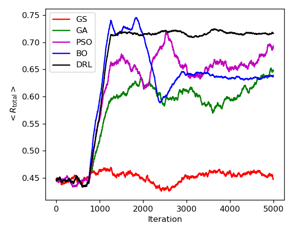
        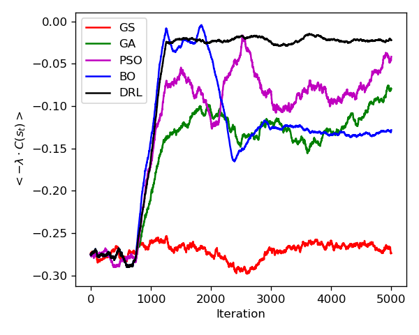
    </p>
</div>

The partial rewards for $\tau_E$, $C$, and $Q$, and the partial penalties for each operational limit:

<div>
    <p float = 'left'>
        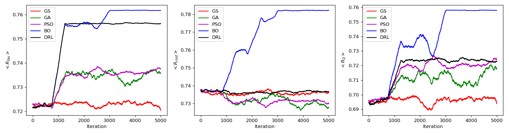
    </p>
</div>

<div>
    <p float = 'left'>
        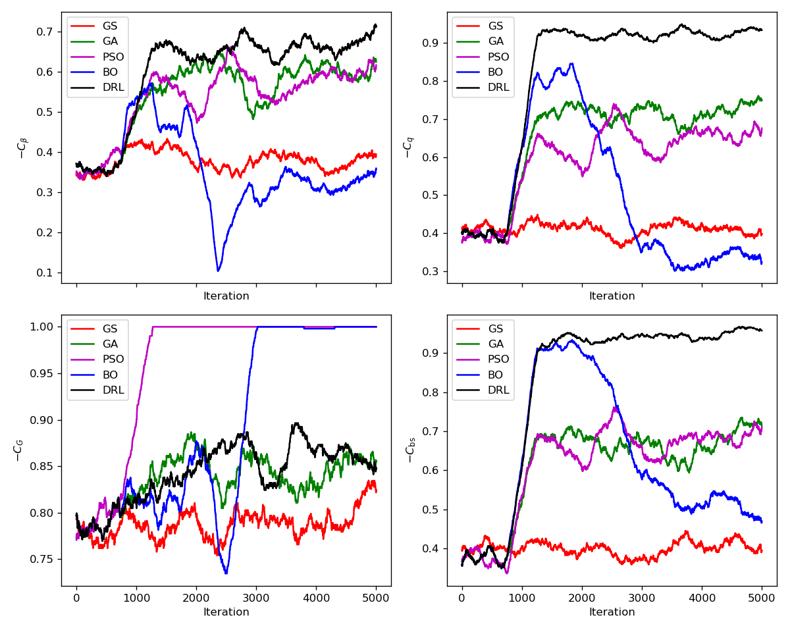
    </p>
</div>

BO achieves the largest cost reduction during optimization, but part of it comes from infeasible candidate designs. DRL yields the most balanced improvement across the competing objectives.

### Proportion of feasible designs
The proportion of feasible designs among all candidate designs explored during optimization:

| GS | GA | PSO | BO | DRL |
|:---:|:---:|:---:|:---:|:---:|
| 0.62% | 3.00% | 1.78% | 2.30% | **11.00%** |

The distributions of the cost $C$, energy confinement time $\tau_E$, and energy gain $Q$ for the designs explored by DRL, plotted against the four constraint ratios. Red dots are feasible designs, and the unshaded regions are the allowed operational regimes. DRL explores a wide range of the design space while still finding a comparatively large number of feasible designs.

<div>
    <p float = 'left'>
        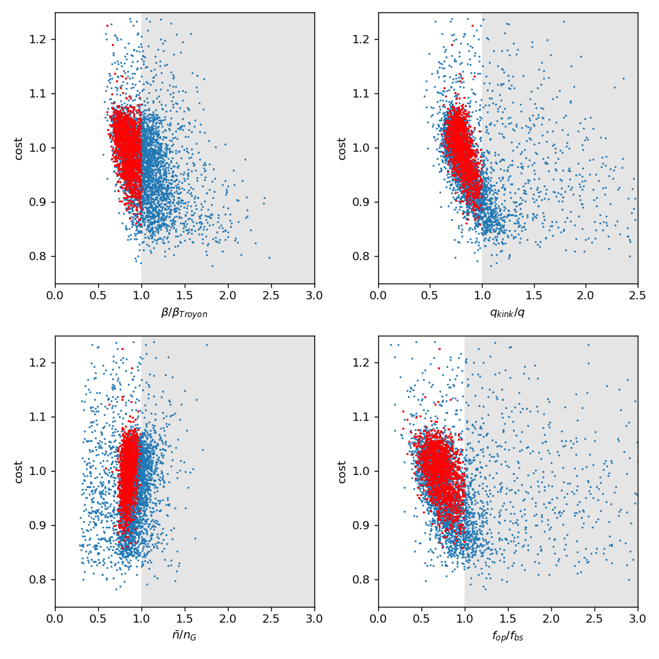
    </p>
</div>

<div>
    <p float = 'left'>
        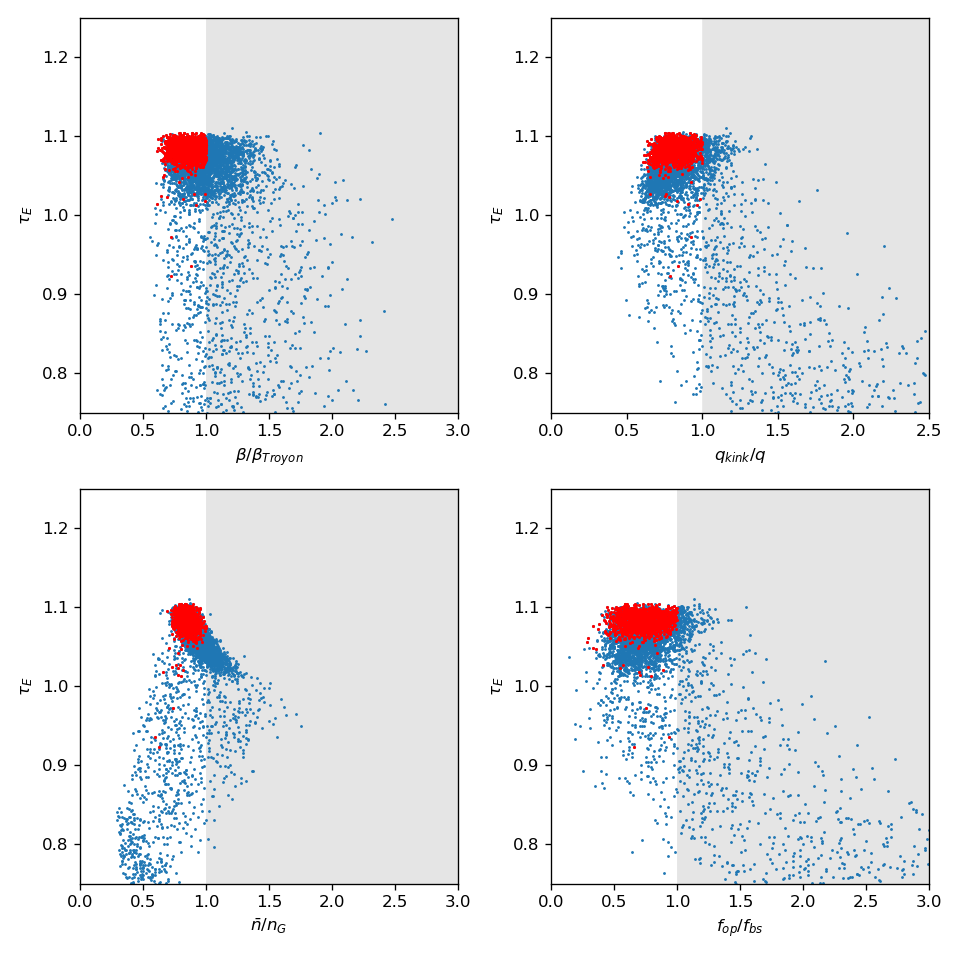
    </p>
</div>

<div>
    <p float = 'left'>
        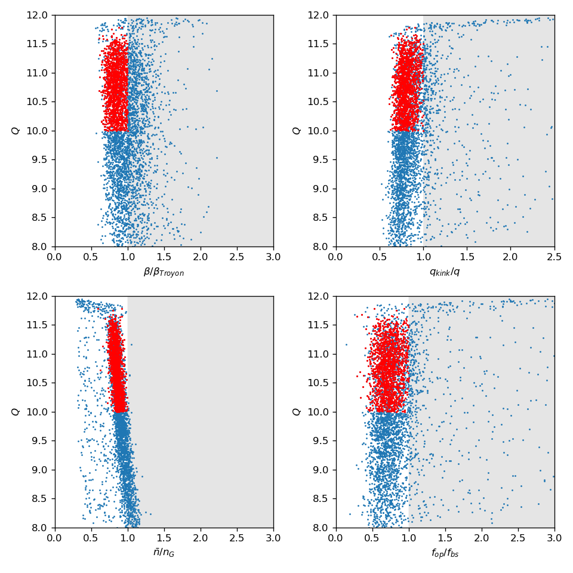
    </p>
</div>

### Optimal design configurations
Design objectives of the reference design and of the optimal designs (feasible, with minimum building cost) found by each method. All methods reduce the building cost while improving the energy confinement time and energy gain.

| | Reference | GS | GA | PSO | BO | DRL |
|:---:|:---:|:---:|:---:|:---:|:---:|:---:|
| $C$ | 1.003 | 0.864 | 0.846 | 0.914 | 0.848 | 0.871 |
| $\tau_E$ (s) | 0.944 | 1.035 | 1.078 | 1.078 | 1.097 | 1.084 |
| $Q$ | 10.380 | 10.394 | 10.958 | 11.017 | 11.828 | 11.000 |

Operational constraint ratios (all must be below 1 for steady-state operation). The reference design violates the kink safety factor and bootstrap fraction conditions, while all optimized designs satisfy every constraint. DRL finds solutions with $q_{\text{kink}}/q$, $\beta/\beta_{\text{Troyon}}$, and $f_{\text{op}}/f_{\text{bs}}$ closest to 1, which places them closer to the Pareto frontier.

| | Reference | GS | GA | PSO | BO | DRL |
|:---:|:---:|:---:|:---:|:---:|:---:|:---:|
| $\bar{n}/n_G$ | 0.560 | 0.823 | 0.815 | 0.770 | 0.819 | 0.779 |
| $q_{\text{kink}}/q$ | 1.278 | 0.890 | 0.847 | 0.795 | 0.826 | 0.979 |
| $\beta/\beta_{\text{Troyon}}$ | 0.942 | 0.928 | 0.955 | 0.751 | 0.935 | 0.987 |
| $f_{\text{op}}/f_{\text{bs}}$ | 1.890 | 0.667 | 0.873 | 0.976 | 0.729 | 0.978 |

<details>
<summary>Full comparison of design parameters</summary>

| | Reference | GS | GA | PSO | BO | DRL |
|:---:|:---:|:---:|:---:|:---:|:---:|:---:|
| $R$ (m) | 5.346 | 6.289 | 5.858 | 5.937 | 5.943 | 6.088 |
| $a$ (m) | 1.337 | 1.566 | 1.671 | 1.671 | 1.698 | 1.716 |
| $\Delta_{\text{blanket}}$ (m) | 1.199 | 1.171 | 1.182 | 1.173 | 1.179 | 1.174 |
| $\Delta_{\text{shield}}$ (m) | 0.1 | 0.1 | 0.1 | 0.1 | 0.1 | 0.1 |
| $\Delta_{\text{TF}}$ (m) | 0.969 | 0.765 | 0.825 | 1.017 | 0.827 | 0.851 |
| $B_{\max}$ (T) | 13.0 | 10.776 | 11.4 | 13.0 | 11.4 | 11.6 |
| $\kappa$ | 1.7 | 1.9 | 1.87 | 1.847 | 1.841 | 1.746 |
| $A$ | 4.0 | 4.017 | 3.505 | 3.552 | 3.5 | 3.547 |
| $H$ | 1.0 | 1.3 | 1.3 | 1.147 | 1.3 | 1.3 |
| $\eta_{\text{thermal}}$ | 0.4 | 0.4 | 0.4 | 0.4 | 0.4 | 0.4 |
| $P_E$ (MW) | 1000.0 | 1500.0 | 1472.8 | 1479.2 | 1500.0 | 1491.5 |
| $P_T$ (MW) | 2500.0 | 3750.5 | 3682.6 | 3698.4 | 3750.5 | 3729.1 |
| $\beta$ | 4.125 | 4.742 | 4.983 | 3.701 | 4.979 | 4.617 |
| $\tau_E$ (s) | 0.944 | 1.035 | 1.078 | 1.078 | 1.100 | 1.084 |
| $I_p$ (MA) | 14.296 | 12.170 | 13.327 | 14.080 | 13.182 | 14.599 |
| $q$ | 1.544 | 2.247 | 2.363 | 2.515 | 2.383 | 2.043 |
| $f_{\text{op}}$ | 0.841 | 0.588 | 0.751 | 0.738 | 0.533 | 0.672 |
| $f_{\text{bs}}$ | 0.445 | 0.881 | 0.860 | 0.757 | 0.898 | 0.687 |
| $Q_{\parallel}$ (MW-T/m) | 500.0 | 567.2 | 577.0 | 663.84 | 582.0 | 582.9 |
| $\bar{T}$ (keV) | 14.0 | 14.0 | 14.4 | 14.5 | 15.0 | 14.4 |
| $\bar{n}$ ($10^{20}$ m $^{-3}$) | 1.43 | 1.30 | 1.24 | 1.23 | 1.20 | 1.23 |
| $\bar{p}$ (atm) | 7.67 | 6.99 | 6.84 | 6.87 | 6.90 | 6.81 |
| $Q$ | 10.38 | 10.39 | 10.96 | 11.02 | 11.83 | 11.00 |
| Cost | 1.003 | 0.864 | 0.846 | 0.914 | 0.848 | 0.871 |

</details>

The optimized designs are generally larger than the reference and produce more fusion power. The building cost is the ratio of volume to generated power, and increasing both (rather than decreasing both) reduces the cost while also improving $\tau_E$ and $Q$. The optimized designs also tend to have a larger elongation, slightly higher temperature and lower density, and a higher safety factor $q$.

Poloidal cross-sections of the reference design and the optimal designs:

<table>
  <tr>
    <td align="center">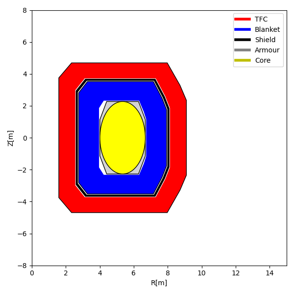<br>Reference</td>
    <td align="center">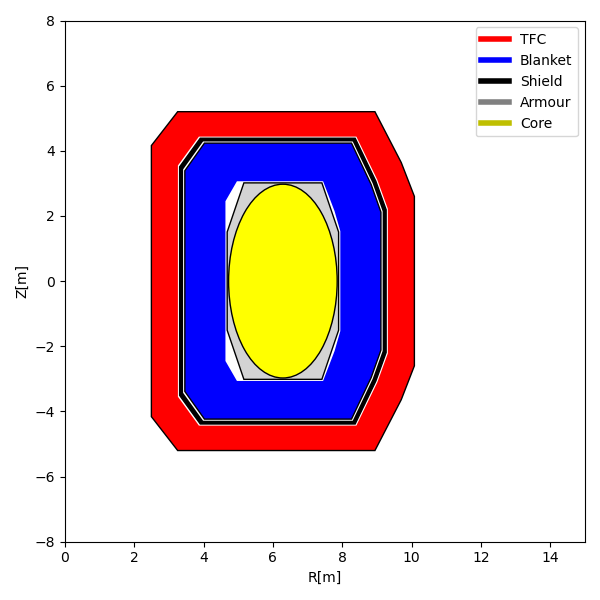<br>GS</td>
    <td align="center">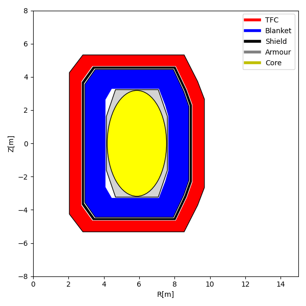<br>GA</td>
  </tr>
  <tr>
    <td align="center">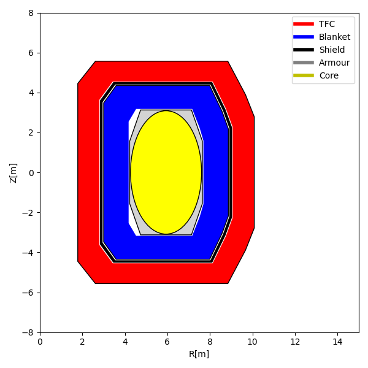<br>PSO</td>
    <td align="center">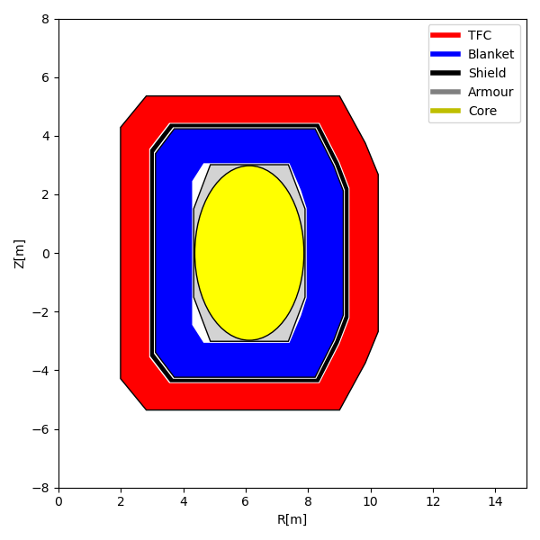<br>BO</td>
    <td align="center">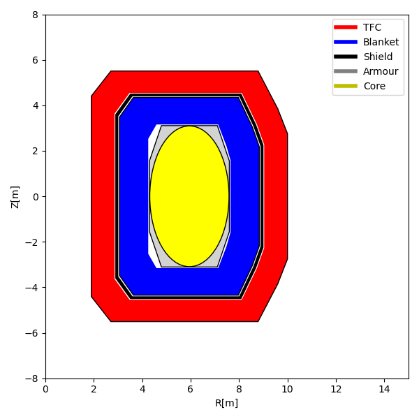<br>DRL</td>
  </tr>
</table>

Operational regime of the reference design (left) and the DRL-optimized design (right) with respect to $a$, $H$, $B_{\max}$, and $P_E$. The black vertical line marks the designed reactor. The reference design fails to reach the safe regime for steady-state operation, while all four curves of the DRL design lie in the unshaded region, so it satisfies all constraints.

<div>
    <p float = 'left'>
        
        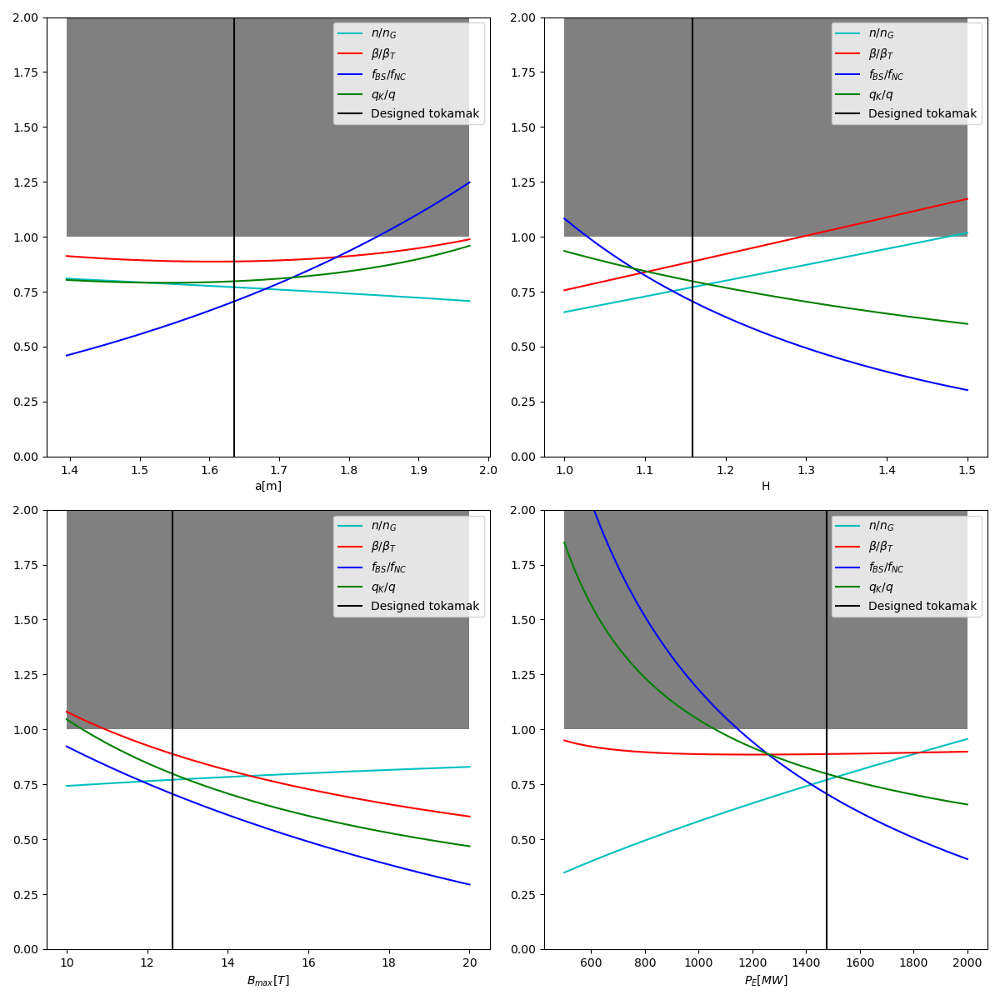
    </p>
</div>

Lawson criterion of the reference and optimized designs:

<div>
    <p float = 'left'>
        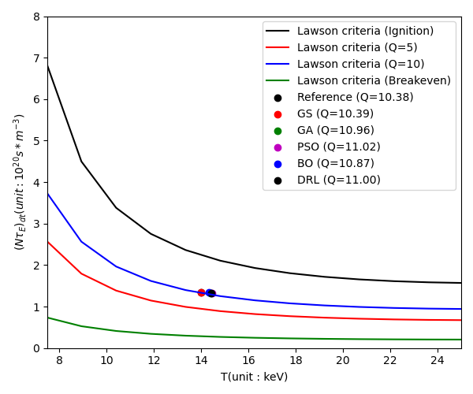
    </p>
</div>

## 📖 Citation
If you use this repository in your research, please cite the following:

### 📜 Research Article
[Design Optimization of Nuclear Fusion Reactor through Deep Reinforcement Learning](https://arxiv.org/abs/2409.08231)  
Jinsu Kim, Jaemin Seo, arXiv:2409.08231, 2024.

```bibtex
@article{kim2024design,
  title   = {Design Optimization of Nuclear Fusion Reactor through Deep Reinforcement Learning},
  author  = {Kim, Jinsu and Seo, Jaemin},
  journal = {arXiv preprint arXiv:2409.08231},
  year    = {2024},
  doi     = {10.48550/arXiv.2409.08231},
  url     = {https://arxiv.org/abs/2409.08231}
}
```

### 📌 Code Repository
Jinsu Kim (2024). **RL-based-Reactor-Design-Optimization**. GitHub.  
[https://github.com/ZINZINBIN/RL-based-Reactor-Design-Optimization/](https://github.com/ZINZINBIN/RL-based-Reactor-Design-Optimization/)

```bibtex
@software{Kim_RL_based_Fusion_2024,
  author  = {Kim, Jinsu},
  title   = {{Deep Reinforcement Learning based Fusion Reactor Design Optimization Code}},
  url     = {https://github.com/ZINZINBIN/RL-based-Reactor-Design-Optimization/},
  license = {MIT},
  version = {1.0.0},
  month   = sep,
  year    = {2024}
}
```
